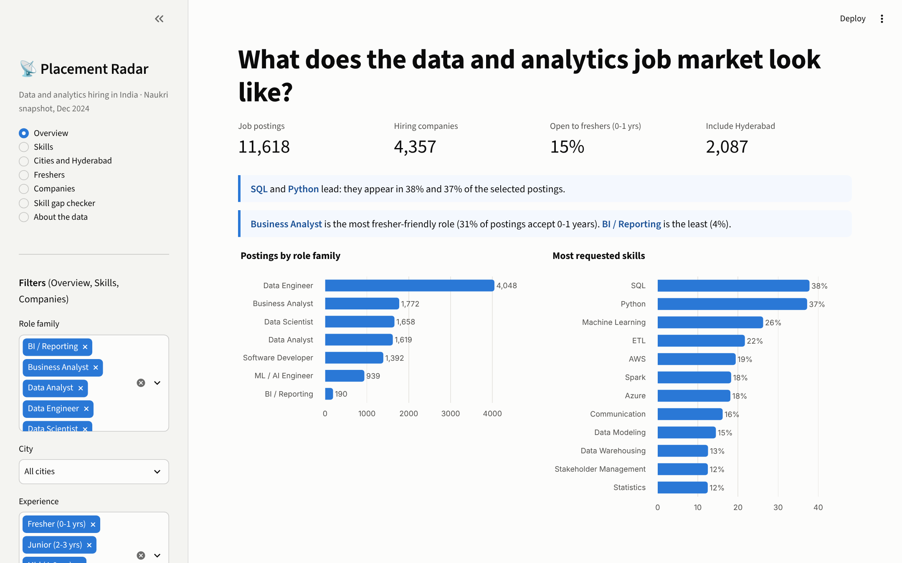
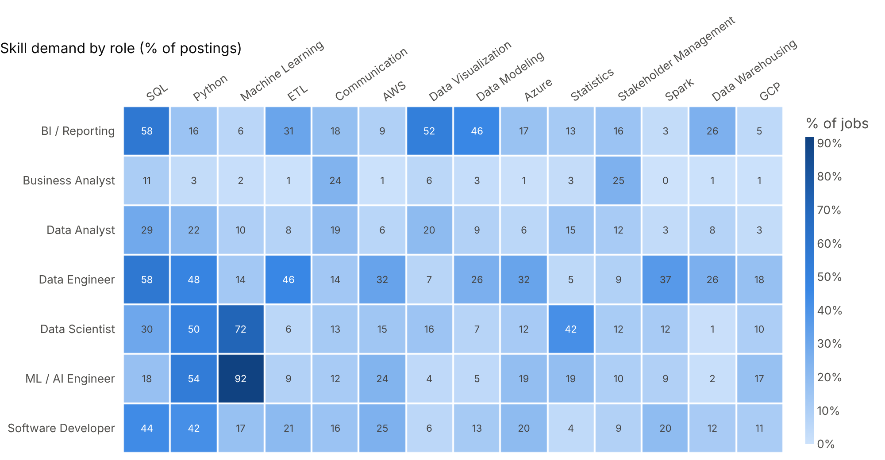
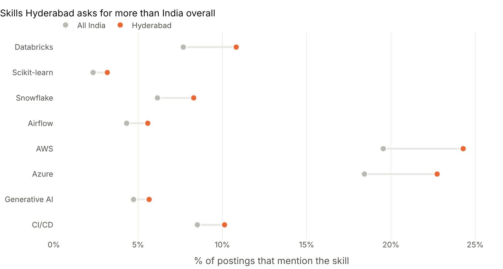
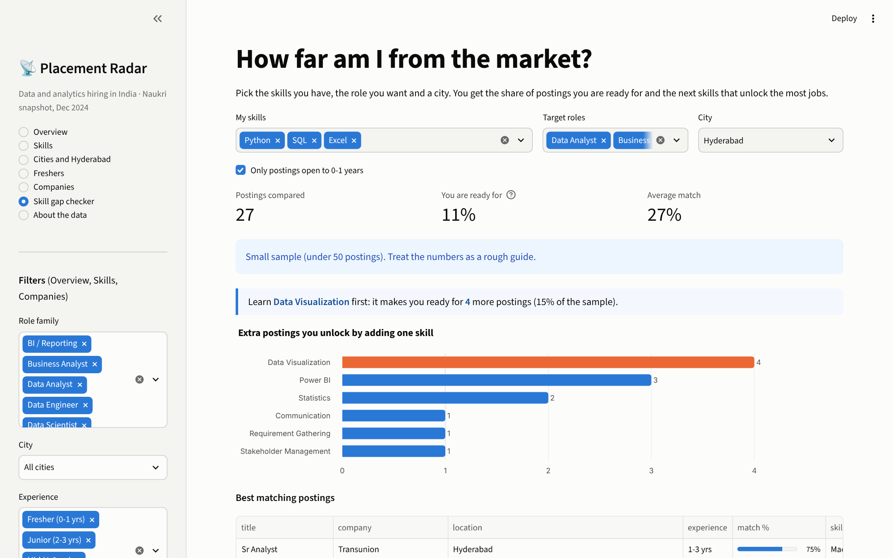

# Placement Radar 📡

A job-market dashboard for freshers targeting data and analytics roles in India, with a focus on Hyderabad.
It answers three questions: **which skills do postings ask for, where are the jobs, and how far am I from them?**

Built with **SQL, Python, Excel and Power BI** (Power BI steps included). The live dashboard is a Streamlit app.



## What the data says

Based on **13,679 job postings from 4,715 companies** (Naukri, snapshot taken in December 2024).

1. **Most postings are not open to freshers, but analyst roles are.** Only 14% of postings accept 0-1 years of experience. Business Analyst (31%) and Data Analyst (30%) accept freshers about four times as often as Data Engineer (7%).
2. **For fresher analyst roles, Python is not the gatekeeper.** In the 1,043 fresher-friendly Business and Data Analyst postings, the most common skills are communication (22%), stakeholder management (20%), requirement gathering (18%), Excel (18%) and SQL (15%). Python appears in 10%.
3. **Hyderabad is the #2 city, but harder for freshers.** It has 2,458 postings (18% of all), behind only Bengaluru (5,070). Its postings ask for cloud and data-platform skills more often than the rest of India (Databricks 1.4x, Snowflake 1.35x, AWS 24% vs 20%), and only 10% are open to freshers, against 14% nationally.

These are patterns in one snapshot of one job board. They are not forecasts and not proof of what employers hire for.

## Pages

| Page | What it shows |
|---|---|
| Overview | Postings, hiring companies, fresher share, top skills and roles |
| Skills | Heatmap of skill demand by role family, and top skills by category |
| Cities and Hyderabad | Postings by city, and the skills Hyderabad asks for more than India overall |
| Freshers | Fresher-friendly share by role, experience bands, companies that hire freshers |
| Companies | Biggest hirers with their employee ratings |
| Skill gap checker | Pick your skills, a role and a city: see the share of postings you are ready for and which single skill unlocks the most more |





## How the skill gap score works

For each posting, **match** = the share of its listed skills that you already have. A posting counts as **ready** when the match is 60% or more.
For each skill you lack, **unlocks** = how many more postings become ready if you add only that skill. Postings with fewer than 3 detected skills are ignored, because a match on 1-2 skills is noise.
The 60% line is a judgement call, not a measured hiring rule.

## Tools and where each is used

| Tool | Used for | Where |
|---|---|---|
| **SQL** (SQLite) | Skill demand, window-function rankings, Hyderabad lift, skill pairs | `sql/queries.sql` |
| **Python** (pandas, Plotly, Streamlit) | Cleaning, skill extraction, gap score, dashboard | `src/`, `app/` |
| **Excel** | A workbook with live formulas, a role x skill heatmap and a gap checker | `exports/Placement_Radar.xlsx` |
| **Power BI** | Star-style model, DAX measures, report steps | `exports/powerbi/`, `docs/POWERBI_GUIDE.md` |

## Run it

```bash
pip install -r requirements.txt
# 1. get the data (see data/raw/README.md), then:
python -m src.clean          # clean data, build processed CSVs and the SQLite database
python -m src.export         # rebuild the Excel workbook and Power BI files
streamlit run app/streamlit_app.py
pytest -q                    # 15 tests
```

The cleaned tables are already in `data/processed/`, so the app runs without the raw file.
To run the SQL: `sqlite3 data/placement_radar.db < sql/queries.sql` (after `python -m src.clean`).

## Project layout

```
app/streamlit_app.py     dashboard
src/clean.py             parsing and cleaning (experience, locations, role family)
src/skills.py            skill vocabulary (45 skills) and extraction
src/analysis.py          demand, city and company summaries, gap score
src/charts.py            Plotly charts (one blue, one orange highlight, blue heatmap)
src/export.py            Excel workbook and Power BI CSVs
sql/queries.sql          7 analysis queries
tests/                   unit tests for parsers, skills and the gap score
docs/POWERBI_GUIDE.md    steps and DAX for the Power BI report
```

## Data

**Source:** *Naukri Jobs Dataset* on Kaggle by muhammetakkurt (`naukri_data_scientist.csv`), https://www.kaggle.com/datasets/muhammetakkurt/naukri-jobs-dataset.
Check the licence on the Kaggle page before reusing it. The raw file is not committed to this repository.

**Cleaning:** 12 duplicate job IDs removed; a placeholder date (1970-01-01) set to missing; multi-city locations split and city names merged (for example "Bangalore/Bengaluru" and "Hyderabad/Secunderabad").

## Limits

- **One snapshot.** Most postings were created in Nov-Dec 2024, so the data cannot show trends over time.
- **Salary is not analysed.** About 91% of postings say "Not disclosed".
- **Skills are keyword matches** on the title, tag list and description, using a list of 45 skills. A mention is not the same as a requirement, and skills outside the list are missed.
- **Role families come from keyword rules on titles.** About 15% of postings fall in "Other" and are hidden by default.
- **The data covers data, analytics and ML roles plus some developer roles.** It is not all of tech hiring.
- **A posting that lists several cities counts once in each city.**
